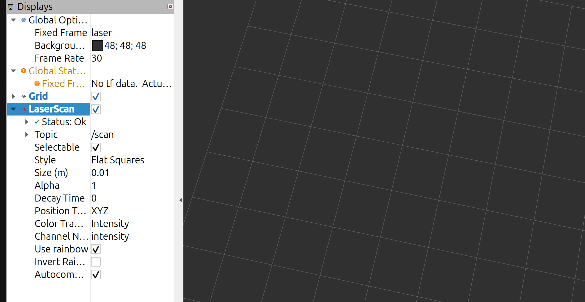

# RB3302 Final Project 

Programmed inputs and optional path-image debugging: see [rb3302_nav](src/rb3302_nav/README.md).
Run the provided planning_astar launch for localisation and navigation. The optional
path_preview client connects to that running stack; it does not start another stack.

This repository contains two ROS 2 workspaces for the RB3302 final project:

- `robot_ws` contains the robot-side nodes used by the lab setup to activate the 2D Lidar, IMU, robot model, and transform definitions.
- `student_ws` contains the mapping and planning packages used in this project.

Both workspaces are located inside `~/rb3302_final_proj_code`.

Packages in this workspace:

```text
mapping_cartographer  - Cartographer algorithm
planning_astar        - Planning with A*
planning_rpp          - Planning with Regulated Pure Pursuit (RPP)
```

## Initialise the Robot

Run this from `robot_ws` before mapping or planning.
Keep this terminal running.

Build once:

```bash
cd ~/rb3302_final_proj_code/robot_ws
colcon build --symlink-install
source ~/rb3302_final_proj_code/robot_ws/install/setup.bash
```

Start the robot-side nodes:

```bash
source ~/rb3302_final_proj_code/robot_ws/install/setup.bash
ros2 launch robot_init robot.launch.py
```

Manual driving:

```bash
source ~/rb3302_final_proj_code/robot_ws/install/setup.bash
ros2 run waverover_base keyboard_teleop
```

On your own computer:

```bash
rviz2
```



## Build

```bash
cd ~/rb3302_final_proj_code
source /opt/ros/jazzy/setup.bash
colcon build --symlink-install
source install/setup.bash
```

### Recover from stale build/install symlinks

The repository currently tracks generated build/install artifacts, including
absolute symlinks to another machine's paths. After cloning or moving the
workspace, these can cause `File exists` during symlink installation and
`local_setup.bash` or package-not-found errors. Regenerate both directories
locally; rebuilding only `mapping_cartographer` will not repair the planning
packages' setup files.

Use a fresh terminal with only the ROS underlay sourced. Back up the old
directories outside the workspace, then build all student packages:

```bash
source /opt/ros/jazzy/setup.bash
cd ~/rb3302_final_proj_code/student_ws
student_build_backup=$(mktemp -d "$HOME/rb3302-student-build-backup.XXXXXX")
if [ -d build ]; then mv build "$student_build_backup/build"; fi
if [ -d install ]; then mv install "$student_build_backup/install"; fi
colcon build --symlink-install --base-paths src
```

After a successful build, use a separate terminal to source and launch:

```bash
source /opt/ros/jazzy/setup.bash
cd ~/rb3302_final_proj_code/student_ws
source install/setup.bash
ros2 pkg prefix mapping_cartographer
ros2 launch mapping_cartographer mapping.launch.py \
  configuration_basename:=cartographer_025.lua resolution:=0.025
```

## Mapping with Cartographer

Config file:

```text
src/mapping_cartographer/config/cartographer.lua
```

Start mapping:

```bash
ros2 launch mapping_cartographer mapping.launch.py
```

Drive the robot around while Cartographer creates the map.

### Evaluate a finer scan-matching grid

Higher spatial resolution means **smaller** cells: `0.025` is 2.5 cm per cell,
compared with the upstream Cartographer default of `0.05` (5 cm). Two settings
have different jobs:

| Setting | Purpose |
| --- | --- |
| `TRAJECTORY_BUILDER_2D.submaps.grid_options_2d.resolution` in Lua | Internal submap grid used for scan matching |
| Launch argument `resolution` | Published `/map` grid, used when saving a map |

Changing only the launch argument does not refine the internal scan-matching
grid. The optional `cartographer_025.lua` config changes only that internal
grid and inherits the rest of `cartographer.lua`.

Build the mapping package from `student_ws` and source it:

```bash
colcon build --symlink-install --packages-select mapping_cartographer
source install/setup.bash
```

Run the baseline first, then stop it before running the finer grid. Both runs
publish at 2.5 cm so map-image comparisons isolate the internal grid change:

```bash
# Baseline internal grid (upstream default: 5 cm).
ros2 launch mapping_cartographer mapping.launch.py \
  configuration_basename:=cartographer.lua resolution:=0.025

# Separate run: internal grid and published map both at 2.5 cm.
ros2 launch mapping_cartographer mapping.launch.py \
  configuration_basename:=cartographer_025.lua resolution:=0.025
```

For a controlled comparison, replay the same recorded `/scan` and required TF
data into each fresh mapping run with `use_sim_time:=true` and rosbag's clock
enabled. Otherwise, drive the same slow route with several turns and a return
to the starting point. Save each map under a separate name, such as
`maps/rb3302_baseline` and `maps/rb3302_025`, while its mapping run is active.
Compare wall thickness/doubled edges, measured room dimensions, alignment on
returning to the start, and processing delay or dropped-scan warnings. Keep the
finer grid only if alignment improves and processing keeps up. Halving cell
size gives roughly four times as many grid cells over the same area; runtime
cost must be measured separately.

This is an experiment, not a verified accuracy improvement. The mapping config
disables both IMU and odometry input, so a finer grid alone may not fix motion
or timing errors. Cartographer's scan matcher already supports sub-cell
alignment; cell size is not a hard bound on pose accuracy. See the upstream
[algorithm explanation](https://google-cartographer-ros.readthedocs.io/en/latest/algo_walkthrough.html)
and [grid defaults](https://github.com/cartographer-project/cartographer/blob/master/configuration_files/trajectory_builder_2d.lua).

Navigation uses AMCL on a saved map, so test the newly generated map with
`ros2 launch planning_rpp planning.launch.py map:="$PWD/maps/rb3302_025.yaml"`
after stopping mapping. Editing the existing saved map's YAML resolution alone
rescales the world instead of adding detail. A new mapping run can also change
the map origin/orientation: recheck `course_letters.yaml` coordinates before
using letter goals. Nav2 costmap resolutions are separate from scan matching.

## Save the Map

Keep mapping running, then open another terminal:

```bash 

mkdir -p ~/rb3302_final_proj_code/student_ws/maps

ros2 run nav2_map_server map_saver_cli -f  ~/rb3302_final_proj_code/student_ws/maps/rb3302_map

```

Save maps here:

```text
~/rb3302_final_proj_code/student_ws/maps/rb3302_map.yaml
~/rb3302_final_proj_code/student_ws/maps/rb3302_map.pgm
```

## Before Using A* or Regulated Pure Pursuit (RPP)

Both planning options use Adaptive Monte Carlo Localisation (AMCL) to localise the robot on the saved map.
After starting either planning package, set the robot's starting pose in RViz with `2D Pose Estimate`, then send a goal.


## Planning with A*

Config file:

```text
src/planning_astar/config/nav2_params.yaml
```

Start planning:

```bash
ros2 launch planning_astar planning.launch.py
```

## Planning with Regulated Pure Pursuit (RPP)

Config file:

```text
src/planning_rpp/config/nav2_params.yaml
```

Start planning:

```bash
ros2 launch planning_rpp planning.launch.py
```

RPP progress timeouts are disabled with `planning_rpp::NoProgressChecker`, which
always accepts progress while keeping Nav2's plugin interface. The stopped goal
checker still decides when a waypoint is complete. Build `planning_rpp` after
changing to this plugin, source the workspace, and restart navigation:

```bash
colcon build --symlink-install --packages-select planning_rpp
source install/setup.bash
```

With `planning_rpp`, the arrival heading follows the final segment of the planned
path (`GridBased.use_final_approach_orientation: true`). This can differ from the
straight line between letter centres when the route goes around a wall. The robot
may make a small final alignment, then the stopped goal checker requires position,
heading (within 0.15 rad), and low measured velocity before completing the goal.

The three-second pause is provided by `WaitAtWaypoint` when using `run_course` /
`FollowWaypoints`. It runs after each successful waypoint, including the last one.
A single RViz goal or `NavigateThroughPoses` request does not invoke this pause.
During the pause no new navigation goal is sent; the completed controller commands
zero velocity. Restart the planning launch after editing its parameters.


Test with Start and Goals Set  
```bash
ros2 run rb3302_nav run_course \
--start S --bearing E --goals H C F K \
--course "$PWD/maps/course_letters.yaml"
```

To record measured letter centres, see the
[calibration instructions](src/rb3302_nav/README.md#calibrate-letter-centres).
F currently uses the confirmed physical-centre reading `(2.396, 0.145)` metres;
the other centres still need measurement.
